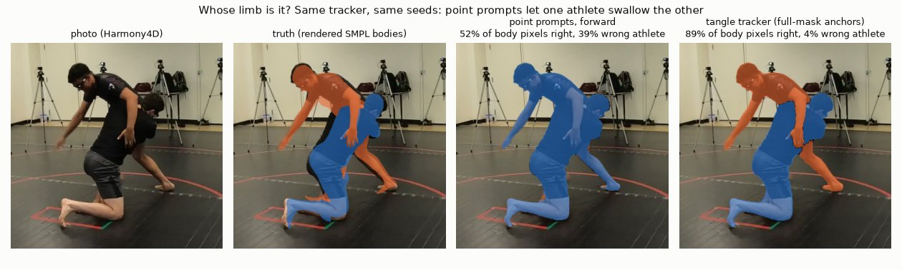

# Whose arm is it? Limb ownership between two entangled people

Research record (August to October 2026) by Dhruva Chakravarthi on one narrow question: when two grapplers are
tangled, which limb belongs to whom? Pixel ownership in close contact is where segmentation, pose and 3D-body models
fail, and every measure of how two people engage (contact, control, a trapped arm) depends on it.

Two routes were tried:
1. **Read it from a vision-language model.** Qwen3.8-27B's own image features and per-athlete language states,
   probed and decoded with controls. **Negative**, after two audits that voided part of the earlier evidence.
2. **Carry it through time.** A video tracker anchored where ownership is known (a modest, blind-confirmed gain),
   then a reviewer's dots as corrections (blind wins, but in-sample: no model improved).

**This is largely a documented negative result.** It is published with its controls, its audits and its mistakes,
because each one rules something out.

## Where it ended (October 2026)
| route | key result | verdict |
|---|---|---|
| frontier VLM -> SAM -> PromptHMR on one armbar clip | the trapped forearm goes to the wrong athlete at every hand-off | fail ([E00](experiments/E00-tool-chain/)) |
| Qwen3.8 actor states + probe / decoder | no better than a matched random code; **0 of 27** trapped-arm cells right | negative ([E01](experiments/E01-qwen-ownership-probe/), [E02](experiments/E02-ownership-decoders/)) |
| audits + final corrected campaign (636 jobs) | token reshape misplaced **14,080 of 14,400** locations; fixed, language states still add nothing; unseen (private) clips at geometry-baseline level | negative, final ([E03](experiments/E03-audits-final-cache/)) |
| tangle tracker (SAM 3.1, full-mask anchors) | Harmony4D tangles 0.845 -> **0.882** right owner; blind **13-2** | pass, modest ([E04](experiments/E04-tangle-tracker/)) |
| reviewer dots as corrections (932 dots, 94 frames) | held-out 75% -> 90%, blind 28-6; random undotted frames +3 points | in-sample only ([E05](experiments/E05-dot-corrections/)) |
| Sapiens parts, SAM 3D Body depth order, outfit colour | resolution floor; more swaps; inherits tracker errors | negative ([E06](experiments/E06-other-ownership-cues/)) |

- **What it led to:** Dhruva judged that the dot rounds improved no model, and moved the question from pixel labels to
  measuring engagement between two 3D bodies, with ground truth and pre-registration:
  [engage3D](https://github.com/dhruvinci/engage3d) ([E07](experiments/E07-what-it-led-to/)).
- **Limits:**
  - the VLM route rests on one armbar clip plus four short clips, with pseudo-labels and AI-reviewed sparse labels,
    not dense human masks;
  - blind A/B verdicts and dots come from one reviewer (Dhruva);
  - only the tracker has a ground-truth benchmark (Harmony4D, standing grappling; no ground work).

## Layout
- `experiments/E<nn>-<name>/`: `README.md` (summary), `RESULTS.md` (curated record; READMEs cite it as
  `RESULTS.md:line`), `data/` (result files). Index: [`experiments/README.md`](experiments/README.md).
- [`FINDINGS.md`](FINDINGS.md): one line per finding, dated.
- `src/`: the code ([`src/README.md`](src/README.md)): `qwen/` (extraction, probes, decoders, final campaign),
  `tangle/` (tracker, Harmony4D benchmark, dot tools, review pages), `limb_demo.py` (all figures).
- `env/`: pinned package lists of the tracker environments. `docs/assets/`: figures.
- This repository is a curated export of a private research workspace; workspace paths in the records are for
  provenance only.

## Data and models (not redistributed here)
- **Harmony4D** (Khirodkar et al., NeurIPS 2024; dataset card: MIT): the tracker benchmark and the only video frame
  shown in this repository.
- **Footage not redistributed, no frames shown:** a third-party armbar clip (E00-E03); four 6-second clips of private
  product footage used as held-out clips in E02-E03 (their results are withheld; only qualitative conclusions appear); the tracker's
  production clips (E04-E06), from public online videos.
- **Models:** Qwen3.8-27B (open weights, its own licence); GPT-5.6 Sol (API); SAM 2.1; SAM 3 / 3.1 and SAM 3D Body
  (SAM License); PromptHMR (non-commercial research); BBoxMaskPose v2 (GPL-3.0; imported at run time by
  `bmp_tangle.py` and `dotfix.py`, not distributed); Sapiens; DINO; SMPL / SMPL-X (their own licences).

## Licence
Code: MIT ([`LICENSE`](LICENSE)). Documents, figures and results: CC BY 4.0 ([`LICENSE-docs`](LICENSE-docs)).
Third-party data and models keep their own licences.

## Citation
See [`CITATION.cff`](CITATION.cff).
