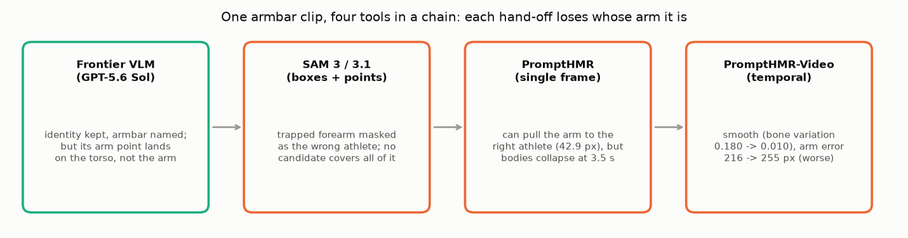

# E00 — Off-the-shelf tool chain on one armbar clip (2026-08-26)

**Objective.** In an armbar one athlete's forearm is trapped against the other's body. Can existing tools, chained,
say whose forearm it is? A frontier VLM for identity and action, SAM for masks, PromptHMR for 3D bodies.

**Setup.**
- One third-party armbar clip (not redistributed): five anchor frames (0.75-5.95 s), then all 146 frames
  ([RESULTS.md:33](RESULTS.md#L33), [:151](RESULTS.md#L151)).
- Chain: GPT-5.6 Sol (identity, boxes, signed points) -> SAM 2.1 / 3 / 3.1 -> PromptHMR -> PromptHMR-Video.
  The planned Qwen3.8-27B API call was refused before inference (`AccessDenied.Unpurchased`) ([:39](RESULTS.md#L39)).

**Results**
| stage | what happened | source |
|---|---|---|
| VLM | named the armbar (confidence 0.94) and kept identities, but put its arm point on the torso | [:162](RESULTS.md#L162), [:101](RESULTS.md#L101) |
| SAM 3 / 3.1 | trapped arm given to the wrong athlete; no candidate covered all 3 arm probes | [:82](RESULTS.md#L82), [:103](RESULTS.md#L103) |
| SAM 3.1 tracking | every propagated arm lost the masks before the final frame | [:120](RESULTS.md#L120) |
| PromptHMR | moved the forearm to the right athlete (42.91 px), but every arm collapsed the bodies at 3.5 s | [:137](RESULTS.md#L137), [:140](RESULTS.md#L140) |
| PromptHMR-Video | smooth (bone variation 0.180 -> 0.010), arm probe error worse (216 -> 255 px) | [:163](RESULTS.md#L163), [:167](RESULTS.md#L167) |

API cost about $0.95 in total ([:86](RESULTS.md#L86), [:173](RESULTS.md#L173)).

**Verdict.** **Fail.** No chain assigned the trapped forearm correctly. A single clip: a diagnosis, not a benchmark.
**Learned.** Recognising the armbar is easier than drawing it: each hand-off (text -> points -> masks -> bodies)
loses whose limb it is, and obeying every click is not correctness ([:193-198](RESULTS.md#L193)).
**Caveat.** A tracker-driving bug found in October may have affected the temporal SAM 3.1 arm; it was not re-checked
([:212](RESULTS.md#L212)).
**Next.** Read actor identity from inside one model instead: Qwen3.8's own representations ([E01](../E01-qwen-ownership-probe/)).

Files: `RESULTS.md` (the ledger). Frames and overlays are not published (third-party footage).
