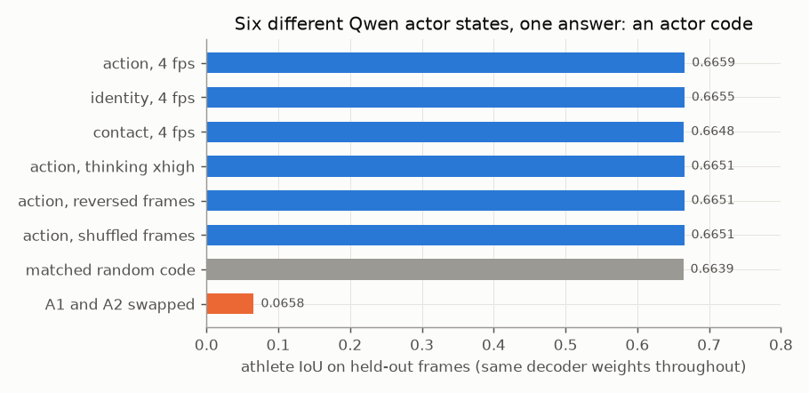

# E01 — Qwen3.8 representations and an ownership probe (2026-08-27)

**Objective.** A VLM that understands "A1 is arm-barring A2" should carry that in its hidden states. Do Qwen3.8's
actor states, added to its image features, tell a small probe which pixels belong to the trapped athlete?

**Setup.**
- Qwen3.8-27B (open weights, revision `1d4bf0f2`), frozen, one rented GPU: all 27 vision layers, the merged visual
  embedding, and a marker state per athlete in all 64 language layers, under identity / action / contact prompts,
  thinking off / xhigh, ordered / reversed / shuffled frames ([RESULTS.md:23](RESULTS.md#L23), [:44-47](RESULTS.md#L44)).
  11,204 artifacts, 146 GiB, about $5.18 ([:26](RESULTS.md#L26), [:30](RESULTS.md#L30)).
- Probe: background / A1 / A2 per patch; vision alone vs vision + actor states; 24 training and 8 held-out frames of the
  armbar clip; frame 143 has 21 hand-checked trapped-arm patches ([:94](RESULTS.md#L94), [:98](RESULTS.md#L98)).
- Decisive control: one trained decoder, only the actor states swapped at test time.

**Results** (held-out frames; positive margin = trapped arm given to the right athlete)
| | athlete IoU, pooled grid | trapped-arm margin |
|---|---|---|
| vision only | **0.693** | -0.66 |
| + action states (thinking off / xhigh) | 0.665 / 0.681 | -0.68 / -0.48 |
| + matched random code | 0.669 | -0.55 |
Sources: [:122-131](RESULTS.md#L122) (full 160x90 grid, same pattern: [:137-146](RESULTS.md#L137)).
- Fixed decoder: six different real states span 0.0011 IoU; swapping A1/A2 flips the whole map (0.0658)
  ([:167](RESULTS.md#L167)). The two athletes' states have cosine 0.998 ([:169](RESULTS.md#L169)).
- Qwen's own answer never named the armbar: "a suplex followed by a triangle" ([:51-52](RESULTS.md#L51)).

**Verdict.** **Negative.** The actor states acted as an identity code, no better than a random one, and the trapped
arm stayed with the wrong athlete in every condition ([:116](RESULTS.md#L116)).
**Caveat.** The image tokens were read in the wrong order ([E03](../E03-audits-final-cache/)): the vision IoUs above
are void. The query findings do not depend on that order and held on corrected features.
**Learned.** One global token per athlete cannot say where a limb is. Sensitivity (states change with the prompt) is
not use.
**Next.** A trainable spatial decoder and stronger controls ([E02](../E02-ownership-decoders/)).

Files: `RESULTS.md`, `data/` (final metrics, fixed-decoder control, per-frame metrics).
