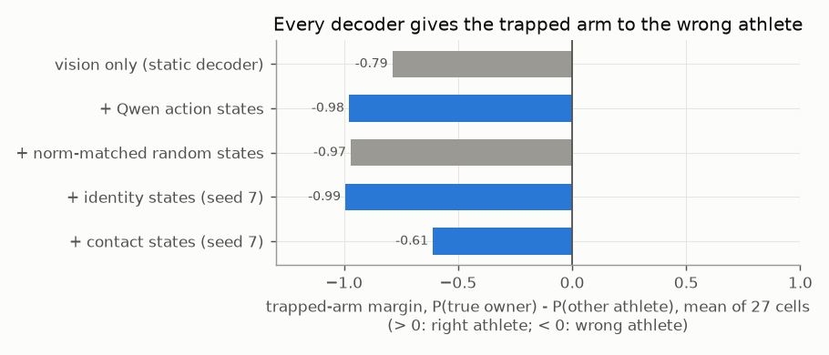

# E02 — Ownership decoders with controls (2026-09-05)

**Objective.** E01's probe was tiny. Give the Qwen features a real decoder: can actor states then fix the trapped arm,
and beat matched random states?

**Setup.**
- A small background / A1 / A2 decoder on frozen Qwen features: 1x1 adapters, width 96, two residual blocks; the
  semantic variant compares each pixel with the two actor states and is exactly A1/A2-swap equivariant
  ([RESULTS.md:54-57](RESULTS.md#L54)). Armbar clip, 24 training / 4 validation / 8 test frames, seeds 7, 71, 701.
- Controls: norm-matched random states, zero and mean states, identity / contact states, ordered / reversed / shuffled
  frames. Pre-set gates; everything else fixed.
- Follow-up (24 jobs): subtract each athlete's identity state to isolate "action" and "contact" directions.

**Results** (8 held-out frames, mean of 3 seeds)
| | athlete IoU | trapped-arm margin | trapped-arm cells right |
|---|---|---|---|
| static decoder (layer 11 + merged embedding) | **0.8746** | -0.79 | 10% |
| + Qwen action states | 0.8663 | -0.98 | **0 of 27** |
| + norm-matched random states | 0.8566 | -0.97 | 0 of 27 |
Sources: [:96-98](RESULTS.md#L96), [:26](RESULTS.md#L26).
- Action vs random: +0.0097 IoU, below the +0.01 gate; every gate but background stability failed ([:104-108](RESULTS.md#L104)).
- Ordered, reversed and shuffled frames: 0.8663 / 0.8665 / 0.8662, indistinguishable ([:122-124](RESULTS.md#L122)).
- Identity subtraction: 6 of 7 gates failed; action +0.009 IoU over raw, +0.002 over random ([:206](RESULTS.md#L206), [:260-261](RESULTS.md#L260)).

**Verdict.** **Negative.** Qwen features segment the two athletes well within the clip; its actor states do not move
the trapped arm, and make the wrong answer more confident.
**Caveat.** The layer-11 input used the misordered tokens ([E03](../E03-audits-final-cache/)); the merged embedding
(not audited) carries most of the signal (0.8546 alone vs 0.8622 combined, [:78-79](RESULTS.md#L78)).
**Learned.** High IoU hides confident errors exactly at the contact. Score the contact separately, always.
**Next.** Audit the inputs before running more ([E03](../E03-audits-final-cache/)).

Files: `RESULTS.md`, `data/` (both campaign results).
