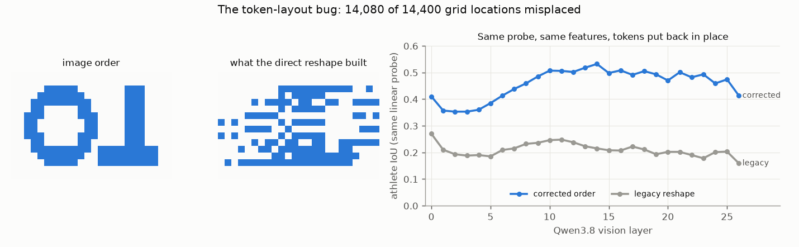

# E03 — Audits and the final cache campaign (2026-09-21, 2026-10-13)

**Objective.** Before spending more, check the inputs. Were the cached Qwen answers and actor labels what we thought?
Were the image tokens in image order? Then run one last, complete analysis of the cache before deleting it.

**Setup.**
- Provenance audit: re-read all 34 cached Qwen answers against the athletes they name.
- Layout audit: an image whose patches encode their own row and column, through the exact pinned image processor.
- Final campaign: 636 jobs on one rented GPU, about $3.4; corrected layout; matched controls (shuffled labels, random /
  zero / mean / wrong-clip states, displaced features); a query-to-patch adapter; temporal adapters with ordered /
  reversed / shuffled frames; four clips of private product footage each held out whole (their numbers are withheld).

**Results**
| finding | number | source |
|---|---|---|
| actor IDs flip between prompts (armbar 2 fps / five-frame runs; one private clip) | 2 clips | [:21](RESULTS.md#L21), [:27](RESULTS.md#L27) |
| an invalid (truncated) answer still produced actor states | one private clip | [:24](RESULTS.md#L24) |
| the main "armbar" answer describes a suplex and a triangle | - | [:33](RESULTS.md#L33) |
| grid locations misplaced by the old token reshape | **14,080 of 14,400** | [:84](RESULTS.md#L84) |
| same probe, legacy -> corrected order (mean of 27 layers) | 0.210 -> **0.458** | [:144](RESULTS.md#L144) |
| decoder with no language states / real states / random states (armbar) | 0.822 / 0.820 / 0.813 | [:160-163](RESULTS.md#L160) |
| temporal adapters: ordered / reversed / shuffled (armbar) | 0.350 / 0.357 / 0.353 | [:175](RESULTS.md#L175) |
| four held-out clips (private product footage): every Qwen input at about the geometry-only level | numbers withheld | [:197](RESULTS.md#L197) |

**Verdict.** **Negative, and final.** The old pooled and full-grid spatial results were void; with the tokens fixed,
Qwen's features segment much better, but its language states still add nothing, nothing transfers to unseen clips,
and frame order does not matter. Earlier claims that "Qwen knows the armbar, the decoder can't use it" were too strong
([:48](RESULTS.md#L48)).
**Learned.** Audit coordinate contracts with a fixture before trusting any spatial number. A model's answer can be
fluent, contract-valid and wrong about the action.
**Next.** The cache was retired. Ownership moved to a tracker that carries identity through time
([E04](../E04-tangle-tracker/)).

Files: `RESULTS.md`, `data/layout-audit.json`, `data/layer-selection.json`, `data/protocol.json`. The 636-job findings
archive is not published (it holds per-frame records of the private clips); `src/qwen/final_cache/summarize_findings.py`
shows how the tables were made.
