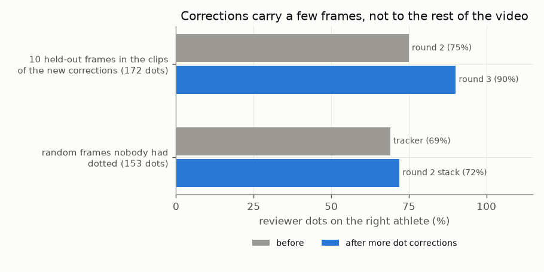

# E05 — Dot-assisted interactive correction (2026-10-13 to 14)

**Objective.** Where the tracker still fails (feet, knees, hands in leg entanglements), let a reviewer mark the truth
with a few dots, turn the dots into corrected masks, and let the tracker carry each correction to nearby frames.
How far does a dot carry?

**Setup.**
- Review pages take red / blue / neither dots, each marking which athlete owns one pixel ([RESULTS.md:16](RESULTS.md#L16)).
  Dhruva placed **932 dots on 94 frames** of leg-entanglement clips, in five packs ([:272](RESULTS.md#L272)).
- Dots -> SAM click refinement of that frame's masks -> new tracker anchors; then corrections held in tracker memory,
  holes filled along the skeleton ("bone fill"), and dots enforced. Models stay frozen: **nothing is trained**.
- Every round scored on dots it never saw, then judged blind on frames nobody had dotted.

**Results** (share of unseen dots on the right athlete)
| | before | after |
|---|---|---|
| 10 held-out frames in the clips of the round-3 corrections (172 dots) | 75% | **90%** |
| random frames nobody had dotted (153 dots) | 69% (tracker) | 72% (round-2 stack) |
Sources: [:157-160](RESULTS.md#L157), [:122-128](RESULTS.md#L122).
- Blind A/B, each round against the last: wide corrections **21-0**, round 2 + memory + bone fill **19-6**, round 3
  **28-6** ([:41](RESULTS.md#L41), [:115](RESULTS.md#L115), [:199](RESULTS.md#L199)). On random frames round 2 went 0-2
  ([:116](RESULTS.md#L116)).
- One corrected frame (10 dots) carried about 3 frames either way ([:167](RESULTS.md#L167)). Corrections turn swaps
  into holes (88 -> 33 swaps, 43 -> 74 holes), and a wrong fill looks worse than a hole ([:42](RESULTS.md#L42), [:131](RESULTS.md#L131)).
- 58 of 600 dots were not honoured by the corrections made from them; enforcing them fixed that ([:223](RESULTS.md#L223)).

**Verdict.** **Works as human-in-the-loop propagation; not progress on the model.** Every blind round won, but each
win measured how far Dhruva's own dots carry to neighbouring frames. On a clip nobody dots, nothing changes. Dhruva's
own review: the rounds improved no model or pipeline ([:258](RESULTS.md#L258)).
**Learned.** Count dots as a test set, or as training data for a model that runs on new video; never as per-frame
patches counted as progress. Report gains on undotted clips or on ground truth.
**Next.** The thread was paused; the work turned to measuring engagement ([E07](../E07-what-it-led-to/)).

Files: `RESULTS.md`. Code: `src/tangle/` (`dotfix.py`, `dotenforce.py`, `bonefill.py`, `tangle_dot_eval.py`).
