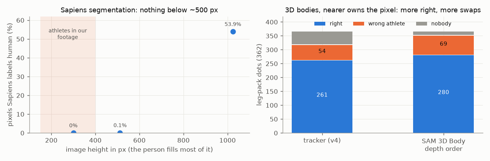

# E06 — Other ownership cues: Sapiens, 3D depth order, outfit colour (2026-10-13 to 14)

**Objective.** Three independent ways to say whose limb a pixel is, tested beside the tracker: body-part segmentation
(Sapiens), two 3D bodies with the nearer one owning each pixel (SAM 3D Body), and each athlete's look (an outfit
colour model per clip).

**Setup.** Each cue scored against Dhruva's dots from E05 (leg pack: 362 dots on 24 frames; later packs for the
outfit model). Baseline: the E04 tracker, 261 of 362 right ([RESULTS.md:42](RESULTS.md#L42)). Frozen models; the
outfit MLP is trained per clip with the scored quarter of the clip held out ([:59](RESULTS.md#L59)).

**Results**
| cue | result | source |
|---|---|---|
| Sapiens 0.6B segmentation | 263 vs 261 of 362: labels almost nothing at our resolution | [:16](RESULTS.md#L16) |
| ... on Meta's demo image | 53.9% human at full size, 0.1% at 512 px, 0% at 300 px; our athletes are 150-400 px | [:18-19](RESULTS.md#L18) |
| SAM 3D Body, nearer body owns | 280 right, but 69 swaps (tracker: 54) | [:43](RESULTS.md#L43) |
| outfit MLP, before round-3 corrections | 292 -> 323 of 423 dots | [:64](RESULTS.md#L64) |
| outfit MLP, on the final tracker | 226 -> 214 of 269 dots (worse) | [:65](RESULTS.md#L65) |
| simple colour model | 87% where confident, 55-61% on hands and feet | [:55](RESULTS.md#L55) |

**Verdict.** **Negative: none was adopted.** Sapiens hits a resolution floor. 3D depth order gets more dots right
but trades holes for swaps and gets some crossings backwards ([:46](RESULTS.md#L46)). The outfit model helped an earlier
tracker stack, then hurt the final one: it learns from the tracker's masks, inherits their errors (3/10 on the hardest
frame, [:67](RESULTS.md#L67)) and is a coin flip on skin ([:71-72](RESULTS.md#L71)).
**Learned.** Test a model on a degraded known-good image before blaming the domain: "Sapiens is bad on BJJ" was
first reported, and was wrong about the cause ([:22](RESULTS.md#L22)). A cue trained on the tracker's output cannot
fix the tracker's systematic errors.
**Not tested.** Sapiens' pose, depth and normal heads; super-resolution first ([:23](RESULTS.md#L23)).
**Next.** [E07](../E07-what-it-led-to/).

Files: `RESULTS.md`. Code: `src/tangle/` (`sapiens_parts.py`, `s3d_own.py`, `mesh_sam.py`, `outfit_probe.py`,
`appearance_probe.py`).
