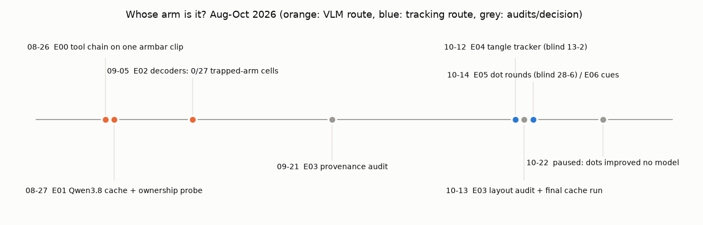

# E07 — What it led to (2026-10-14 to 26)

**Objective.** Record why the thread stopped and where the question went.

**Setup.** No new experiment; dated decisions from E00-E06 and the follow-on work ([RESULTS.md](RESULTS.md)).

**Results**
| route | best result | why it stopped |
|---|---|---|
| VLM semantics (Qwen3.8, E00-E03) | language states no better than random; 0/27 trapped-arm cells | negative after audits; cache retired |
| tracking (E04) | Harmony4D 0.845 -> 0.882; blind 13-2 | residual errors are feet and knees in leg locks |
| human dots (E05) | held-out 75% -> 90%; blind 28-6 | in-sample propagation; no model improved ([RESULTS.md:15-19](RESULTS.md#L15)) |
| other cues (E06) | none adopted | resolution floor, swaps, inherited errors |

- 2026-10-14: Dhruva restated the goal as understanding and measuring engagement; masks are a means
  ([RESULTS.md:6-13](RESULTS.md#L6)).
- 2026-10-22: dots became a test set, not progress; the thread was paused ([RESULTS.md:15-19](RESULTS.md#L15)).
- After: engagement measured as relations between two 3D bodies (contact, distance, limbs threading loops), with
  Harmony4D 3D truth and pre-registration: [engage3D](https://github.com/dhruvinci/engage3d) ([RESULTS.md:21-28](RESULTS.md#L21)).

**Verdict.** The ownership question, as pixel labels on one camera, was the wrong unit of progress. The useful
outputs were a benchmark (Harmony4D ownership), a review method (blind A/B + dots), and audits.
**Learned.** Ask before each round: does this change what the system does on a clip nobody labelled?
**Next.** Limb error inside tangles is still the open problem, now in 3D (engage3D).

Files: `RESULTS.md`.
